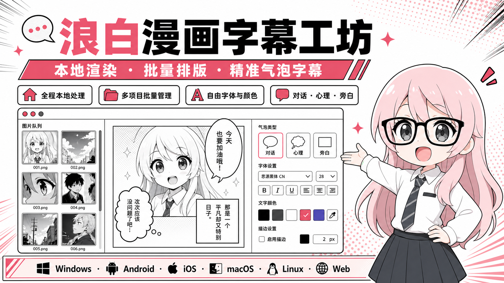

# 浪白漫画字幕工坊

<p align="center">
  
</p>

<p align="center">
  <strong>全本地渲染的批量漫画气泡与文字编辑器</strong><br>
  按图片顺序导入字幕，在保留原图的基础上添加气泡、无框文字和图片素材。
</p>

<p align="center">
  <a href="https://github.com/2786886095/langbai-manga-caption-studio/releases/latest"><strong>下载已发布版本</strong></a>
  ·
  <a href="https://2786886095.github.io/langbai-manga-caption-studio/"><strong>打开已发布 Web 在线版</strong></a>
  ·
  <a href="AI字幕脚本生成指南.md">AI 字幕脚本指南</a>
  ·
  <a href="字幕导入格式规范.md">字幕格式规范</a>
</p>

> **1.3.0：编辑工作台重构。** 本次发布增加项目级撤销、固定字号、十种本地字体、BCS v3 和统一保存/导出流程。源码实现、自动测试、平台构建、安装及实机使用是不同证据层次，不能互相替代。Windows Setup 内更新、手机真机和性能指标仍需独立验收。详见[操作指南](docs/commercial-refactor.md)和[设计与交互验证记录](design-qa.md)。

> **1.3.1：字号两挡。** 新建气泡和纯文字统一默认 200 上限自动挡，自动寻找 8–200 内可容纳正文的最大字号。手动挡保留指定字号，脚本仅修改正文时不会重置已有手动样式。正式下载与在线体验以本次发布记录为准。

> **1.3.2：全局字号默认与批量切挡。** 设置里可选择新建文字的自动／手动默认档位；可明确勾选同时应用到当前项目全部文字。属性批量应用也可独立选择档位和范围，不再暗中复制当前对象的模式。下载与上线状态以 GitHub 发布记录为准。

## 软件能做什么

| 工作内容 | 用途 |
| --- | --- |
| 项目与图片顺序 | 创建、切换项目；默认按名称自然排序，再确认最终顺序。字幕按确认顺序对应，不靠文件名猜匹配 |
| 气泡与无框文字 | 对话、心理、旁白、耳语、惊喊与纯文字；纯文字不绘制气泡底色、外框和尾巴 |
| 图片素材 | 静态 PNG、JPG、WebP 可放入气泡或作为独立元素；全局表情包库由用户专门添加素材 |
| 精准脚本 | 原图像素尺寸、稳定气泡 ID 和矩形坐标；可随时导出整个项目完整 BCS 文本 |
| 本地工程与成图 | 原图和文字分开编辑，工程备份用于继续修改，PNG 用于阅读；BCS 不包含图片素材 |

编辑和渲染不依赖图片生成服务或字体 CDN。检查软件更新、访问 GitHub，以及用户另行使用外部 AI 服务仍需要网络。Web 本地数据属于当前浏览器和站点存储；清除站点数据或更换浏览器不会自动转移项目。

## 统一编辑工作台

- **分开处理选中、输入和草稿**：点击对象出现调整框，点击画布空白取消选框；输入文字不应因实时预览刷新失去光标或输入法状态。
- **章节文本与多选**：在列表定位或勾选对象，批量应用前选择当前图片、已勾选对象或整个章节，并勾选真正需要同步的属性。
- **统一对象数据**：预览、保存和导出从当前对象数据生成；脚本窗口是草稿，取消不应用，再次导入通过稳定 ID 合并正文、样式与位置。
- **关联文字样式**：给一组文字样式命名并关联多个对象；修改关联样式会同步关联对象，独立修改前先解除关联。它不是固定比例气泡预设。
- **明确的保存与导出反馈**：区分等待保存、正在保存、成功提交和失败重试；技术预检指出缺字、缺字体、超框等问题，导出支持取消和失败重试。

## 手动挡与自动挡

首次使用，新建气泡、旁白和纯文字统一默认**自动挡，上限 200**。在设置中可把全局默认改为手动，并填写新建对象的手动字号。自动挡在 8–200 中寻找能完整容纳正文的最大字号；框变大字也可以变大，框变小则缩小。达到最小 8 仍放不下时提示超框，不丢字、不继续缩成不可读文字。

**手动挡**使用你指定的字号，拉框不会偷偷改字号。自动挡显示统一上限和实际字号，不提供无效的手动字号滑块；切换到手动挡后可精确修改。已有明确手动字号保留，已有自动挡采用新的全局最大适配规则。

**文字描边**与**气泡边框**是两项设置。纯文字可以添加文字描边提高对比度，但不会因此出现气泡底色、外框或尾巴。字距与文字对齐也单独设置。

### 批量统一手动／自动

1. 选中任意气泡或纯文字，点击“选择属性并应用到全部”。
2. 确认范围：默认全部图片，可改当前图片、指定图片或章节勾选对象。
3. 勾选“字号模式”，明确选择“自动挡”或“手动挡”，再点击“应用”。未勾选模式时不改变原模式。
4. 自动挡统一使用上限 200；只切手动挡会保留每个对象当前实际字号，不会突然放大成 200。要统一手动字号，再勾选“字体大小”，使用来源对象当前可见的字号。
5. 只应用勾选属性，不改正文、矩形和图片绑定。实际变化对象按原批量格式化规则解除文字样式关联，未改变对象保持关联；可一次撤销或重做，成功保存后重开仍保留。取消和没有实际变化的操作不新增撤销记录。

### 设置中的全局默认

打开右上角“设置” → “全局默认字号模式”，选择自动挡或手动挡。手动挡可填写新建对象字号（8–200，初始 34）；保存后后续新建气泡、旁白和纯文字，以及未指定模式的新脚本对象均使用此默认。明确指定模式的脚本、旧工程和复制对象仍保留自己的模式，不会因升级或重新打开被覆盖。

需要连已有文字一起统一时，在工程内打开设置，勾选“同时应用到当前项目全部文字／气泡”，再保存。此操作涵盖当前项目全部图片、可一次撤销或重做，不修改其它项目。自动挡统一上限 200；手动挡冻结各对象当前实际显示字号，已是手动的保留原值，不把新建对象的默认字号强加给已有对象。实际变化对象解除关联样式，无变化对象保持关联。仅保存默认、取消或无变化不产生项目撤销记录。

## 本地字体库

内置十种完整字体：思源黑体（Noto Sans SC）、站酷小薇、马善政毛笔、思源宋体（Noto Serif SC）、霞鹜文楷、站酷快乐体、站酷庆科黄油、刘建毛草、龙藏体、知芒行。

支持搜索、分类、收藏、最近使用，以及当前字幕的真实字体预览；一次导入多个独立 **TTF/OTF** 文件。字体显示名称读取文件内部名称表，相同内容改名后自动复用。

内置与用户字体按需读取，不在启动时一次加载全部字体。完整本地资源、来源、SHA256 和许可见[字体清单](assets/fonts/fonts_manifest.json)。用户字体存入本地全局库，并在工程需要时保存为工程资源。**BCS 只记名称和素材 ID，不备份字体字节**。

缺字体或缺字会提示，不把原字体标识静默改成默认字体；临时替代与正式替换分开。请确认字体许可允许使用、嵌入及必要的再分发，不能把“可商用”理解为“可随工程分发”。第一版不导入 TTC 集合或 WOFF/WOFF2，也不在线下载字体。

## 具体使用

1. **建项目、确认图片顺序**：添加图片，确认顺序和原始尺寸。
2. **导入并应用字幕草稿**：导入 UTF-8 TXT，检查图片段、尺寸和对象 ID；只修改需要的正文、样式或位置，取消不改变当前工程。
3. **精确编辑**：点击对象修改属性和位置。无框文字使用“添加文字”；纯黑直角旁白框使用“旁白”。
4. **批量维护**：用章节文本列表定位或勾选对象，选择属性及应用范围。需要共同文字样式时建立关联，需要局部例外时解除关联。
5. **确认保存并备份**：等待成功保存提示或手动保存；定期导出完整工程，也可导出完整 BCS。
6. **选择图片并导出**：右上角批量导出中勾选图片，处理技术警告并确认目录；覆盖同名文件前确认，失败时可重试失败图片。

取消导出不会删除之前已写出的图片。浏览器回退下载仅表示已把文件交给浏览器，不能证明已写入目标目录；检查下载记录，必要时允许本站点多文件下载或使用逐图保存。

## BCS v3 与 v2

默认导出 **BCS v3**，继续读取旧版 v1/v2。v3 记录字号模式、文字描边、字距、对齐、字体素材身份和关联样式，并用 `@正文行数` 保留准确正文，包括空行和以 `@`、`#` 或图片段标记开头的文字。

v2 兼容导出先提示属性损失；它不记录固定字号模式、字体素材 ID、文字描边、字距、对齐或样式关联，旧版导入按兼容自动适应方式显示。带首尾空白、特殊开头、空行或空气泡的内容也不要用 v2 做无损备份。

### 完整 v3 纯文字段示例

```text
@格式=BCS顺序字幕脚本
@版本=3
@坐标单位=px

[图片 1]
@原文件名=scene-001.png
@原图尺寸=1080x1920

@气泡ID=p1-b1
@矩形=80,100,520,260
@尾巴=右下
@气泡=纯文字
@字体=Noto Sans SC
@字号=200
@颜色=#141518
@行距=1.25
@描边=3
@白底透明度=100
@字号模式=自动适配
@文字描边=1
@文字描边颜色=#FFFFFF
@字距=0
@对齐=居中
@正文行数=1
你迟到了整整十分钟！
```

坐标使用原图像素。纯文字的矩形只是排版与编辑区域，合法尾巴字段不会显示尾巴。每张图片都保留连续图片段，包括无字幕图片；`@正文行数` 后精确数量的行就是正文。

## 保存、撤销和历史版本

| 操作 | 含义 |
| --- | --- |
| 自动/手动保存 | 提交当前修订，只有提交完成才应显示已保存；失败时保留修改并提示重试 |
| 撤销/重做 | 当前编辑会话的操作历史；连续输入可成组回退 |
| 保存版本历史 | 近期已成功提交的保存版本；恢复会形成新修订，并可撤销恢复操作 |
| 打开其他工程 | 先提交当前项目，再把导入工程创建为新项目，不覆盖当前项目身份 |
| 完整工程备份 | 另存包含原图和所需字体资源的工程文件，用于跨设备迁移或独立备份 |

软件闪退、断电或系统终止时，只能以最后成功提交的版本为恢复依据。不能承诺恢复尚在内存、尚未提交的全部输入。重要修改后确认保存成功，定期备份，不把“等待保存”当成已落盘。

## 下载与设备验证边界

[GitHub Releases](https://github.com/2786886095/langbai-manga-caption-studio/releases/latest) 是正式版本入口。下面是发布渠道的包形式；提供安装包不表示所有平台真机流程均已验证。

| 平台 | 包形式 | 限制与待验证范围 |
| --- | --- | --- |
| Windows | Setup EXE、便携 EXE | 安装后运行与 Setup 内更新需端到端实测，源码或更新清单不代替实测 |
| Android | APK、AAB | APK 用于设备安装，AAB 用于商店流程；需实机验证横竖屏、文件选择与字体导入 |
| iOS | 未签名 IPA | 需要合适签名及安装途径，不是普通设备可直接安装或已上架的证明 |
| macOS | ZIP 应用包 | 需分别核对签名、公证、安全提示及实际运行 |
| Linux | x64 TAR.GZ | 需核对运行依赖和实际桌面使用 |
| Web | GitHub Pages、ZIP | 本地浏览器存储；目录导出依浏览器能力，否则通过下载/逐图保存 |

## 常用快捷键

| 快捷键 | 操作 |
| --- | --- |
| `Ctrl + S` | 保存当前工程 |
| `Ctrl + O` | 打开工程文件并创建为新项目 |
| `Ctrl + Z` / `Ctrl + Y` | 撤销 / 重做 |
| `Ctrl + D` | 复制当前气泡/文字对象 |
| `Delete` | 删除选中对象；输入文字时以文字编辑行为为准 |
| 鼠标右键 / 移动端长按 | 剪切、复制、粘贴、全选文字 |

## 本地开发

```powershell
flutter pub get
flutter analyze
flutter test
flutter build web --release --no-web-resources-cdn
.\tools\prepare_desktop_web.ps1
cd desktop-shell
pnpm install
pnpm run dist
```

推送 `v*` 标签触发现有发布工作流。发布前需核对版本配套、验证边界和用户确认。完整本地字体增加包体，实际安装大小、启动和大项目性能以构建与测试为准。

## 技术、参考与许可证

核心为 Flutter，Windows 发布方案使用 Electron 提供文件存储、目录导出和安装更新桥接。研究参考 Clip Studio Paint、Photoshop、Affinity、BallonsTranslator、comic-translate 和 LabelPlus 的公开工作流程；参考思路不代表复制源码、界面或字体资源。

AI 指南：[简体中文](AI字幕脚本生成指南.md) · [繁體中文](guides/ai_guide_zh_TW.md) · [English](guides/ai_guide_en.md) · [日本語](guides/ai_guide_ja.md) · [한국어](guides/ai_guide_ko.md)。BCS 字段名保持固定；新增界面翻译和平台可用性仍需独立验证。

软件：[MIT](LICENSE)。字体分别遵循随附许可；用户导入素材和字体不自动变为本项目许可证。
